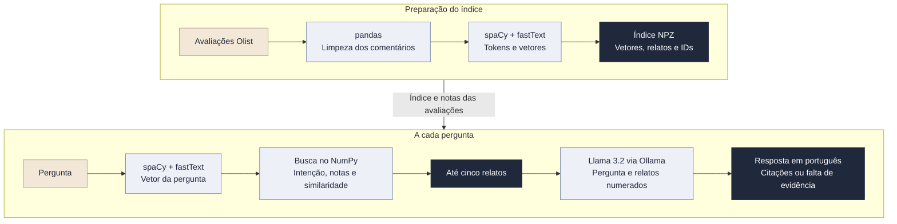

# Voice of Customer Intelligence com RAG

Projeto do Tech Challenge da Fase 4. O objetivo é ajudar gestores e analistas a investigar reclamações e elogios nas avaliações da Olist. A proposta usa RAG para recuperar comentários relevantes e fornecê-los como contexto para respostas em português, com citações que permitem conferir cada observação.

A aplicação roda localmente e permite fazer perguntas pelo navegador ou pelo terminal. O Llama 3.2 gera respostas em português com base nas avaliações recuperadas, e as fontes numeradas permitem localizar os relatos usados.

## Pré-processamento das avaliações

O script `main.py` lê `database/olist_order_reviews_dataset.csv`. O texto usado na preparação vem da coluna `review_comment_message`.

A função de limpeza converte valores ausentes em texto vazio, remove espaços nas pontas e reduz espaços repetidos, tabulações e quebras de linha a um único espaço. Para ser mantida, a mensagem precisa conter ao menos uma letra ou um número. Esse critério exclui campos vazios, pontuação isolada e mensagens compostas só por emojis. A grafia, os acentos e a pontuação das mensagens válidas são preservados.

| Resultado da preparação | Avaliações |
| --- | ---: |
| Total de linhas lidas | 99.224 |
| Com mensagem válida | 40.827 |
| Sem mensagem válida | 58.397 |

### Como executar o pré-processamento

Coloque `olist_order_reviews_dataset.csv` na pasta `database`. Na raiz do projeto, instale as dependências e execute o script.

```powershell
python -m pip install -r requirements.txt
python main.py
```

O terminal mostra as contagens e uma prévia das cinco primeiras avaliações filtradas. O script exporta `database/avaliacoes_limpas.csv` com as colunas `review_id`, `order_id` e `mensagem_limpa`, sem gravar o índice do DataFrame. O par de IDs ajuda a localizar a avaliação de origem.

## Embeddings e busca semântica

O tokenizador de português do spaCy separa as palavras dos comentários, das perguntas e das frases usadas para identificar a intenção. A mesma tokenização é usada na geração do índice e na busca.

O script `testar_embeddings.py` usa o Gensim para carregar o fastText pré-treinado na Wikipédia em português. Cada avaliação recebe um vetor de **300 dimensões**, calculado pela média dos vetores das palavras e normalizado para a comparação por similaridade de cosseno. A consulta passa pelo mesmo processo.

Ao gerar o índice, `testar_embeddings.py` também permite experimentar a busca com três resultados. A aplicação e a consulta com Llama reutilizam o índice salvo e recuperam até cinco comentários do índice de **40.827 avaliações**, com filtro por nota conforme a intenção da pergunta. A pontuação mede a proximidade entre os vetores. Para avaliar a relevância, confira o texto recuperado.

### Como gerar o índice e testar a busca

1. Baixe e extraia o binário do modelo em português. Coloque `wiki.pt.bin` na raiz do projeto, ao lado de `testar_embeddings.py`. [Vetores pré-treinados do fastText](https://fasttext.cc/docs/en/pretrained-vectors)
2. Abra `testar_embeddings.py` no VS Code e clique em **Executar Arquivo Python**. A versão atual recalcula os vetores a cada execução e salva `database/indice_avaliacoes_spacy.npz`.
3. Quando aparecer **Sua pergunta**, digite uma consulta, como “Algum cliente relatou que não recebeu o produto?”. Pressione Enter com a linha vazia para sair.

### Como verificar o índice salvo

Execute `verifica_indice.py` no VS Code. O script reabre o índice sem carregar o fastText, confere os **40.827 vetores de 300 dimensões** e compara os IDs e comentários com o CSV, na mesma ordem. O índice também registra o nome do modelo usado.

## Como funciona o RAG



1. O spaCy separa a pergunta em tokens. O Gensim consulta o fastText, e o NumPy calcula a média dos vetores e normaliza o resultado, como na preparação dos comentários.
2. A busca compara o vetor da pergunta com frases de exemplo para identificar a intenção. Quando a intenção é negativa, considera notas 1 e 2. Quando é positiva, considera notas 4 e 5. Para perguntas gerais ou ambíguas, considera todas as notas. As notas vêm do CSV original e são associadas pelo par de IDs. O NumPy seleciona até cinco relatos elegíveis pela similaridade de cosseno.
3. O script envia a pergunta e os relatos selecionados e numerados ao **Llama 3.2 (3B)** pelo **Ollama**.
4. O modelo recebe instruções para responder em português, citar as fontes usadas e indicar quando os relatos forem insuficientes. Cada número remete a um comentário e ao par `review_id` e `order_id` exibidos na interface.

Cada comentário é uma unidade de busca para manter o relato junto dos seus identificadores. O fastText oferece vetores em português que podem ser usados localmente. O arquivo NumPy reúne os vetores e seus metadados para reutilização nas consultas.

## Como abrir a aplicação web

Depois de instalar as dependências, colocar `wiki.pt.bin` na raiz e gerar o índice, instale e abra o Ollama. No terminal da pasta do projeto, execute:

```powershell
ollama pull llama3.2:3b
python app_web.py
```

Aguarde o carregamento do fastText e abra [a aplicação local](http://127.0.0.1:8000/). Digite uma pergunta ou escolha um dos exemplos e clique em **Buscar avaliações**. A página mostra a resposta e até cinco relatos recuperados, com seus identificadores. A marca **Citada** indica que a resposta referenciou aquele relato pelo número. Quando há uma resposta sem citações, a página exibe os relatos recuperados com um aviso. Se a resposta começa com uma indicação reconhecida de falta de evidências e não traz citações, o painel fica oculto.

A interface usa HTML, JavaScript e Bootstrap. O servidor usa `http.server`, da biblioteca padrão do Python. Para usar o mesmo fluxo no terminal, execute `python "buscar_avaliações.py"`.

## Exemplos de exploração

- Quais são os principais problemas relatados pelos clientes em suas avaliações?
- O que os clientes relatam sobre problemas relacionados à entrega?
- Quais aspectos da experiência de compra são mais elogiados pelos clientes?
- Quais padrões podem ser identificados nas avaliações de clientes insatisfeitos?
- Quais avaliações sustentam a conclusão de que existem problemas recorrentes relacionados ao prazo de entrega?

### Testes fora do escopo

- Qual era o faturamento da Olist em 2018?
- Qual é a capital da Austrália?

Para essas perguntas, espera-se que o modelo indique que os relatos recuperados são insuficientes, sem inventar uma resposta.

## Limitações observadas

A busca pode recuperar comentários sobre o mesmo tema com sentidos diferentes, como elogios a entregas no prazo em consultas sobre atrasos. A resposta resume os relatos recuperados. Perguntas sobre frequência ou rankings na base inteira exigem uma análise quantitativa separada. Nos testes, o modelo citou o relato da caixa rasgada e reconheceu a falta de evidências para responder sobre faturamento. No teste sobre atendimento, deixou de aproveitar parte de um relato relevante.

## Fonte dos dados

[Brazilian E-Commerce Public Dataset by Olist](https://www.kaggle.com/datasets/olistbr/brazilian-ecommerce/data)